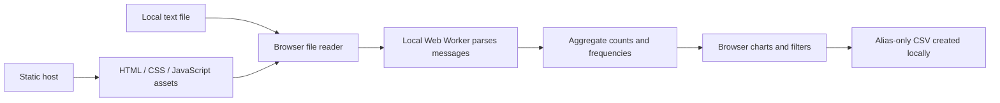

# WhatsApp Chat Insights

**Live application:** [Open Whatsapp Chat Insights](https://subhash-chat-insights.pages.dev) · [Source code](https://github.com/subhashdixit/whatsapp-chat-insights)

Analyze an exported WhatsApp **text** chat locally in your browser: message counts, participation, activity over time, optional word/emoji frequencies and an alias-only summary export. The original exploratory notebook/report is preserved, while this application requires no Python analytics server.

**Try the included synthetic demo first.** Its 240 messages and three fictional participants are generated sample data, not a real private chat.

## How to use it

1. Export a chat **without media** from WhatsApp and select the resulting `.txt` file. A ZIP, PDF, screenshot, database backup or encrypted archive is not a text export.
2. Choose **day/month/year** or **month/day/year** explicitly. `03/04/24` is ambiguous; the app will not guess your intended calendar.
3. Start analysis. The browser parses supported Android/iOS-style timestamps, then shows aggregate counts and charts.
4. Filter by date and participant to examine counts, monthly activity and hour-of-day patterns.
5. Participant names are aliased by default. Showing real names changes only the local display. Optional word/emoji frequencies refer to the **full parsed chat**, not the filtered date/participant subset; the UI labels that distinction.
6. Download an aggregate CSV with aliases and counts. It excludes message text, original names and word-frequency details.
7. Use **Reset** to clear the interface and terminate the worker. This clears application references; it does not promise forensic erasure of browser memory or delete the original file on your computer.

## Privacy and architecture



There is **no upload endpoint, remote analytics script, external font/CDN, browser database or application local-storage persistence**. Analysis runs in a **Web Worker in your browser**; that is different from a server-side Cloudflare Worker. The worker returns aggregates rather than a message-body array and is terminated after analysis. Starting another file/demo cancels the previous analysis so stale results cannot overwrite the new request.

The static host still serves the website and can observe ordinary connection metadata such as IP address and asset requests. Browser extensions, the operating system, shared screens and anyone with access to your computer remain outside this app's control. Do not assume a local tool makes sharing someone else's conversation appropriate. No actual chat export is included in this repository.

## What the parser supports

- Common Android timestamps such as `31/12/2024, 10:15 - Name: text` and iOS-style bracketed timestamps.
- English AM/PM where present, year-first or explicit day/month ordering where supported, and multiline message bodies.
- Sender separation using `: `, with system events counted separately.
- Counts of invalid timestamp headers and text that could not be assigned to a supported message.
- Limits of **10 MiB**, **200,000 lines**, **100,000 messages** and **5,000 participants** to bound local memory and execution.

Locale-specific punctuation, translated AM/PM markers, unusual sender names containing the delimiter, edited export conventions and nonstandard system events can be misinterpreted. Counts are only as complete as the export and parser coverage. A displayed warning is a reason to inspect the format, not to assume every line was understood.

Dates are placed into UTC-backed buckets to preserve the text's displayed wall-clock fields consistently. The app does **not** infer participant timezones or convert timestamps into actual UTC instants. An hour-of-day chart describes the export's written clock, not every participant's local time.

## Concepts behind the charts

| View | What it answers | What it cannot establish |
|---|---|---|
| Participant counts | How many parsed messages each alias sent | Effort, sentiment or relationship quality. |
| Monthly activity | When the exported conversation was more active | Why activity changed or whether deleted messages existed. |
| Hourly distribution | Which written hours contain messages | Actual timezone-aware sleep/work patterns. |
| Word frequency | Common tokens under a simple tokenization rule | Intent, semantic topics or psychological traits. |
| Emoji frequency | Frequent matched emoji sequences | Reliable sentiment across contexts and cultures. |

A message count gives equal weight to “OK” and a long paragraph. Word frequencies omit conversational context and can include personal information; they stay local and are not part of the summary CSV. This is descriptive analysis, not a trained NLP model. There is no training/evaluation accuracy metric because there is no prediction task; parser fixtures and aggregation checks provide the relevant evidence instead.

## Run locally and test

Use Node.js 22+ for tests and Python 3.10+ for the local server/package utility. No npm dependency download is needed.

```bash
git clone https://github.com/subhashdixit/whatsapp-chat-insights.git
cd whatsapp-chat-insights
node --test tests/*.test.js
node --check site/app.js
node --check site/parser.js
node --check site/worker.js
python3 -m http.server 8000 --directory site
```

Open `http://127.0.0.1:8000`, choose the demo and exercise filters, aliases, CSV download and Reset. Tests cover Android/iOS examples, multiline messages, AM/PM, date-order handling, invalid dates, system messages, aggregation and safety limits. They do not guarantee every WhatsApp locale/export variant is supported.

```text
site/index.html       interface
site/parser.js        bounded parser and aggregation
site/worker.js        local background processing
site/app.js           controls, filters and race/cancellation handling
site/charts.js        local SVG charts and safe CSV helpers
site/samples/demo.txt fictional demonstration export
site/_headers         Cloudflare response-header configuration
scripts/package.py    release ZIP containing only site assets
tests/                parser and aggregation fixtures
```

The content security policy restricts scripts and workers to this origin. Cloudflare header configuration adds no-sniff, no-referrer and frame restrictions. Response headers are checked after hosting; a local `http.server` does not implement Cloudflare's `_headers` file. Safe DOM text handling avoids interpreting chat content as HTML. CSV fields are escaped against spreadsheet formula interpretation.

## Manual Cloudflare Pages deployment

This project intentionally demonstrates a **manual static release**, without a custom CI/CD workflow. It is a useful contrast with the automated GitHub Pages projects, and requires discipline: run tests for each release.

1. Run the tests and JavaScript syntax checks above.
2. Optionally validate the packaging utility with `python -m pip install black==25.1.0 pylint==3.3.8`, `python -m black --check scripts`, and `python -m pylint scripts`.
3. Create the upload artifact:

```bash
python3 scripts/package.py
```

4. The output is `dist/chat-insights.zip`. It contains only `site/` contents with `index.html` at the ZIP root, not private files, source notebooks or the virtual environment.
5. Sign in to Cloudflare, create a **Pages Direct Upload** project, choose the ZIP and deploy. The provider assigns a `pages.dev` address. There is no server runtime or paid database requirement.
6. Open the assigned URL, run the synthetic demo, check date/participant filters and download the alias-only CSV. Inspect response headers and verify that selecting a local file does not send its content over the network.
7. Record the deployed Git commit and keep its ZIP as the release artifact. The verified deployment is linked at the top of this README. Its initial release is commit `55c0a6719b7e0ef228f8909ef6dec6c488d3dbb8`.

Hosting stores and serves the static application files. Deployment replaces those files with a specific tested build. The chat file stays in the browser; it is not part of the release artifact. A provider's free plan and limits can change; consult [Cloudflare's current Pages limits](https://developers.cloudflare.com/pages/platform/limits/).

**Tradeoff:** manual upload is simple and shows exactly what is published, but it has no automatic test gate and can publish a stale/wrong ZIP. Cloudflare Direct Upload projects cannot be converted in place to Git integration; use a new project if switching that deployment method later. See the [official Direct Upload guide](https://developers.cloudflare.com/pages/get-started/direct-upload/).

**Rollback:** use the provider's previous successful deployment where available, or re-upload the ZIP built from a known-good Git commit. Re-run the demo and parser checks. Versioning records source changes; rollback restores a release, not the private local files users analyzed. Docker adds no serving benefit here because the entire runtime is the browser.

## Scope and extensions

The app does not read your WhatsApp account, fetch messages, decrypt backups, analyze media or infer relationships. Future parser support should be added with small synthetic fixtures for the new format, including failure cases. Avoid committing a real conversation as a regression test.
